# lmimg

> The public README, docs, images, and examples for `lmimg` are MIT under `LICENSE-examples`. Binary releases use `LICENSE`; implementation source and its history are maintained privately in `lmctlhq/lmimg`.

Image editing, compositing and procedural graphics from scripts: a static ImageMagick core with original GIMP-style layers, masks, curves, healing and LUTs. Every picture below is produced by the one-line command under it, from an empty directory, with no photographs or extra files.

[](https://github.com/lmctl-ai/lmimg/actions/workflows/public-ci.yml)
[](https://github.com/lmctl-ai/lmimg/releases)
[](LICENSE-examples)

### Photo retouching and looks

| | |
| --- | --- |
| **Portrait retouch**: three blemishes healed with a shading-aware patch, exposure lifted, warmed, vignetted, sharpened.<br>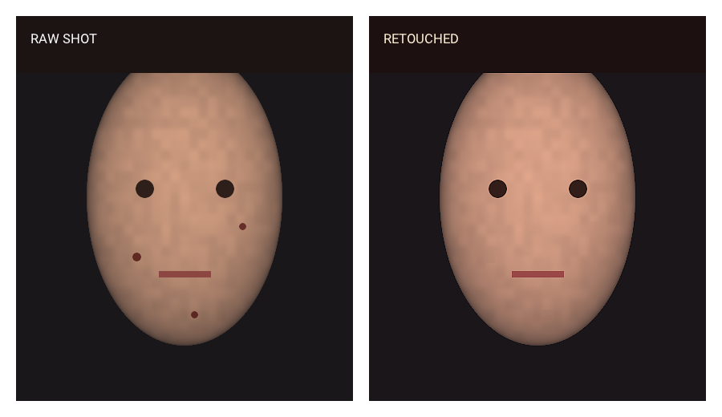<br>`lmctl autorun https://raw.githubusercontent.com/lmctl-ai/lmimg/main/examples/portrait_retouch.lms` | **Exposure brackets and tone mapping**: one 8-bit frame clips the window; EV -2/0/+2 merged and tone-mapped keep both the view and the shadows.<br>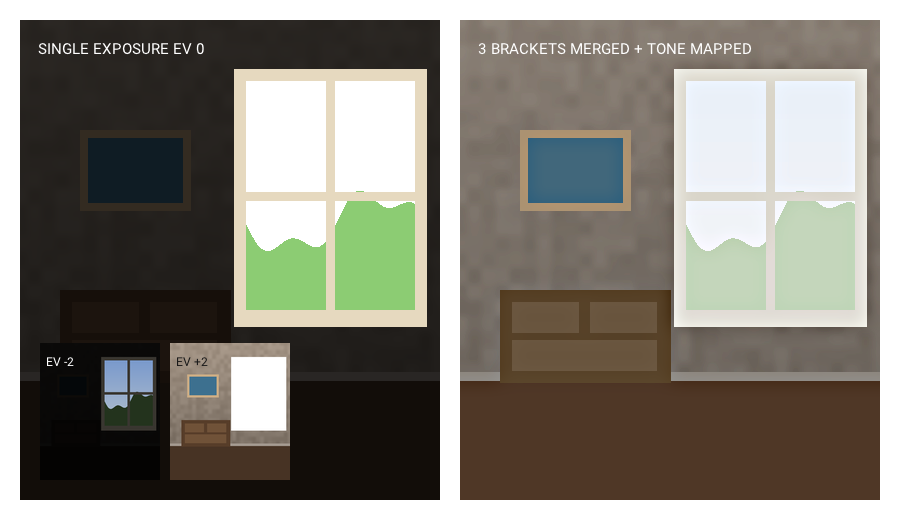<br>`lmctl autorun https://raw.githubusercontent.com/lmctl-ai/lmimg/main/examples/hdr_tone_map.lms` |
| **Tilt-shift miniature**: a focus band, saturation and a vignette turn an aerial view into a model (PSNR inside vs outside the band is asserted).<br>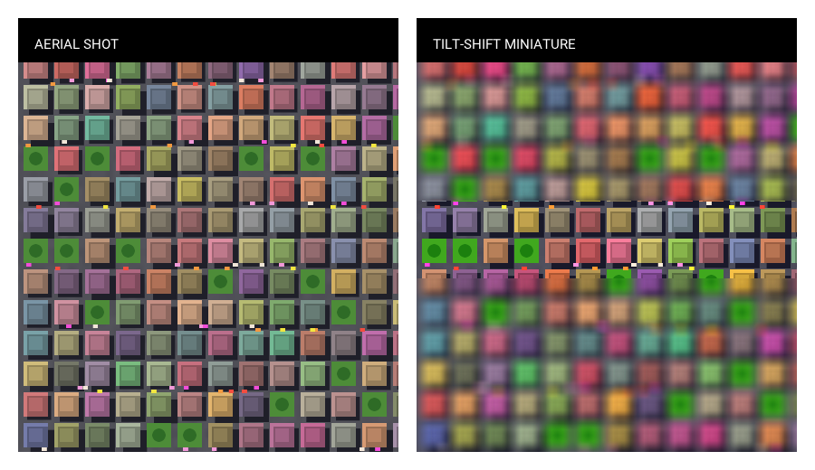<br>`lmctl autorun https://raw.githubusercontent.com/lmctl-ai/lmimg/main/examples/miniature_tilt_shift.lms` | **Layers and masks**: a gradient-masked ND layer, a multiply plate and a screen glow rendered with `img.layers`, the GIMP way.<br>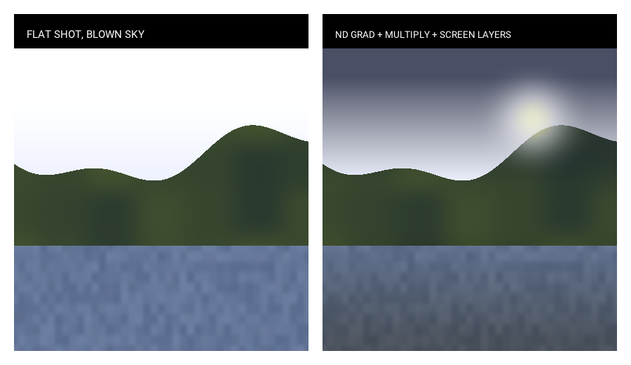<br>`lmctl autorun https://raw.githubusercontent.com/lmctl-ai/lmimg/main/examples/graduated_nd_layers.lms` |
| **Colour grading LUT**: a teal-and-orange look baked into a Hald CLUT PNG and applied to two shots with `clut()`; checked against grading directly.<br>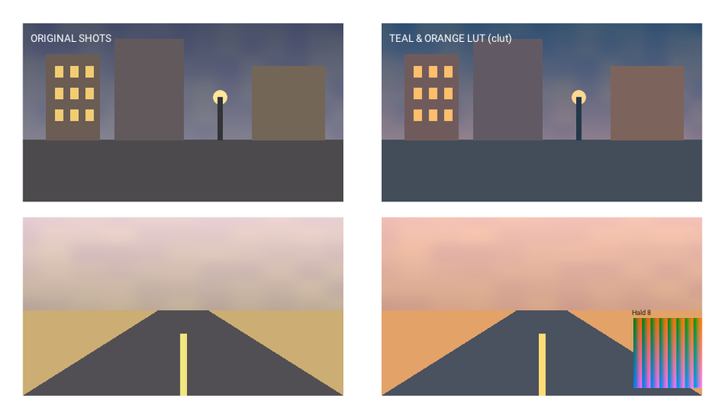<br>`lmctl autorun https://raw.githubusercontent.com/lmctl-ai/lmimg/main/examples/color_grade_lut.lms` | **Procedural photo grade**: a shaded still life with levels, white balance, vignette and unsharp mask.<br>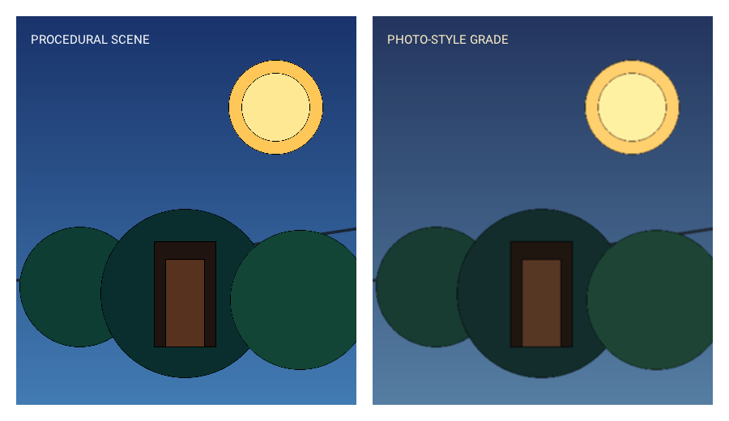<br>`lmctl autorun https://raw.githubusercontent.com/lmctl-ai/lmimg/main/examples/procedural_photo.lms` |

### Documents, labels and design

| | |
| --- | --- |
| **Scan cleanup**: uneven light and grain removed by dilate-estimated background, `divide` blend and a threshold.<br>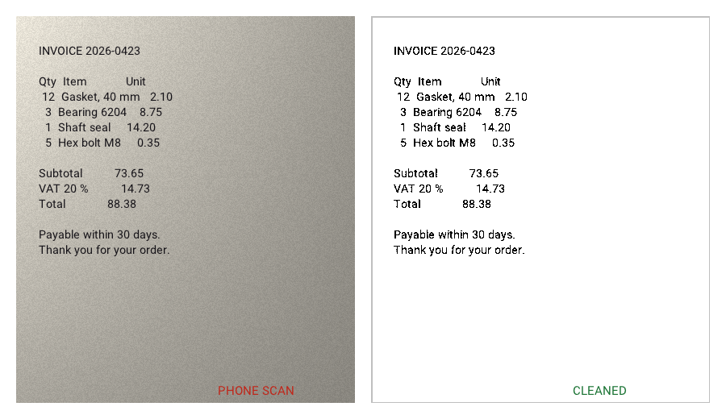<br>`lmctl autorun https://raw.githubusercontent.com/lmctl-ai/lmimg/main/examples/document_scan_cleanup.lms` | **EAN-13 label**: the real L/G/R module tables and check digit, drawn then read back module by module.<br>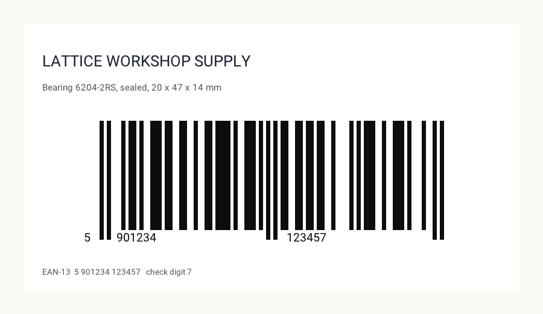<br>`lmctl autorun https://raw.githubusercontent.com/lmctl-ai/lmimg/main/examples/barcode_label.lms` |
| **Event poster**: centred type with `img.text_width`, a blurred-layer drop shadow, textured gradient and a date pill.<br>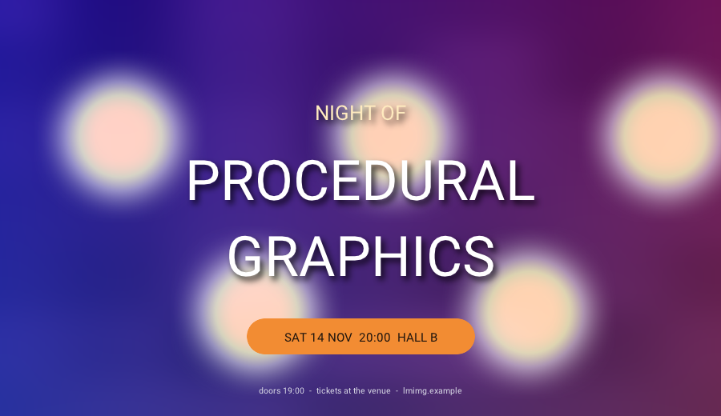<br>`lmctl autorun https://raw.githubusercontent.com/lmctl-ai/lmimg/main/examples/poster_text.lms` | **Tiled watermark**: a rotated text layer tiled at low opacity over a stock preview; PSNR measures how subtle it is.<br>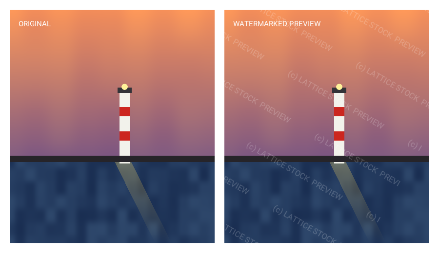<br>`lmctl autorun https://raw.githubusercontent.com/lmctl-ai/lmimg/main/examples/watermark_tiled.lms` |

### Measurement, QA and calibration

| | |
| --- | --- |
| **Visual regression heat map**: difference blend, normalised and false-coloured, with PSNR/SSIM on the figure.<br>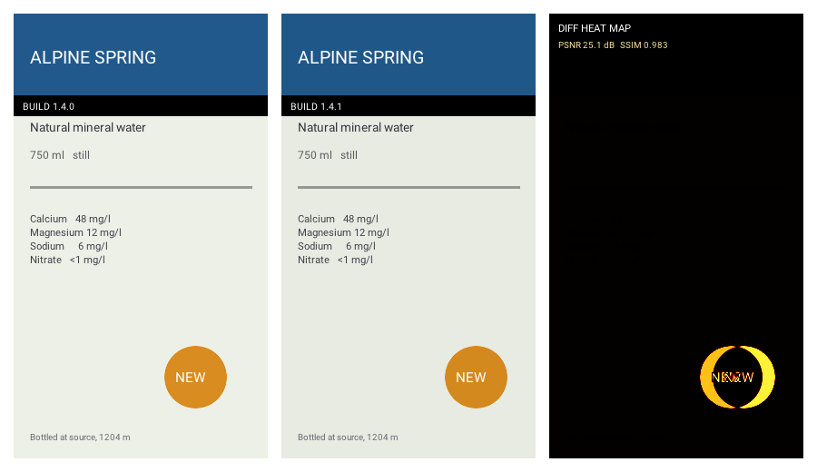<br>`lmctl autorun https://raw.githubusercontent.com/lmctl-ai/lmimg/main/examples/image_diff_heatmap.lms` | **Histogram equalisation, with the histograms** (lmimg + lmplot): 256-bin CSV exports plotted under the before/after frames.<br>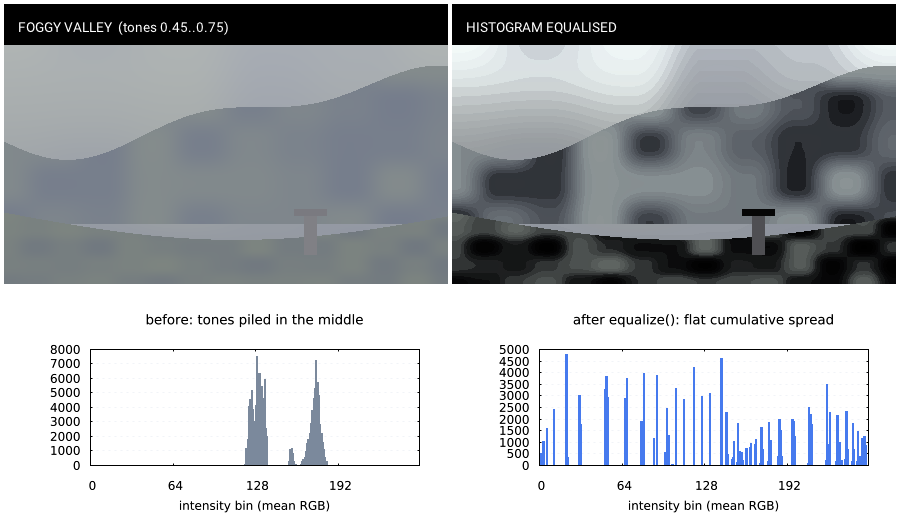<br>`lmctl autorun https://raw.githubusercontent.com/lmctl-ai/lmimg/main/examples/histogram_equalize_plot.lms` |
| **Annotated pipeline** (lmimg + lmdraw): every stage thumbnail is real output; the diagram's claims are asserted by the script.<br>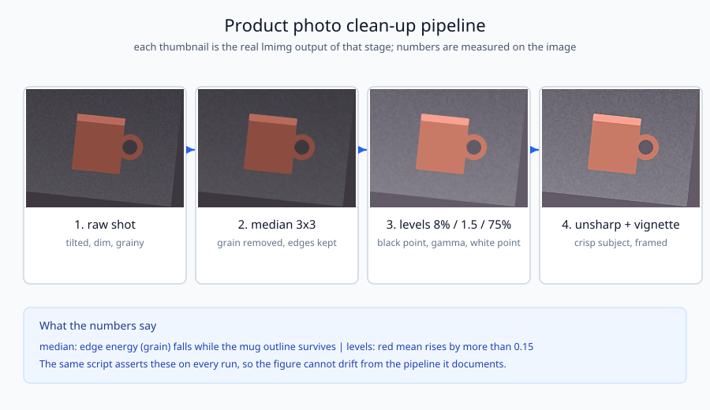<br>`lmctl autorun https://raw.githubusercontent.com/lmctl-ai/lmimg/main/examples/pipeline_diagram.lms` | **Salt-and-pepper denoise**: a 3x3 median beats a Gaussian blur by 5 dB on a corrupted drawing.<br>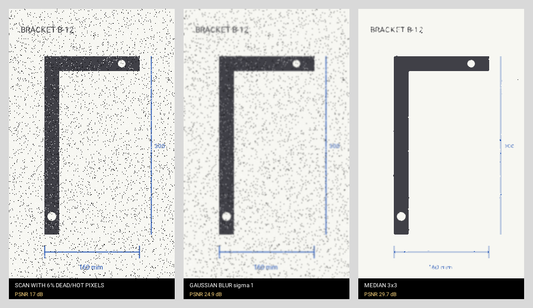<br>`lmctl autorun https://raw.githubusercontent.com/lmctl-ai/lmimg/main/examples/salt_pepper_denoise.lms` |
| **Keystone correction**: the inverse homography derived in-script from four corners rectifies a whiteboard photo; grid straightness is measured.<br>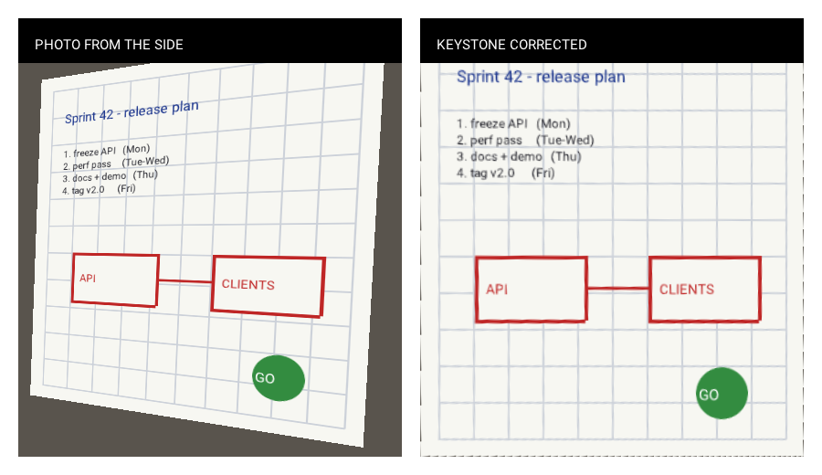<br>`lmctl autorun https://raw.githubusercontent.com/lmctl-ai/lmimg/main/examples/perspective_whiteboard.lms` | **Lens calibration**: barrel distortion bows a grid line by 36 px; a swept inverse coefficient leaves 5 px.<br>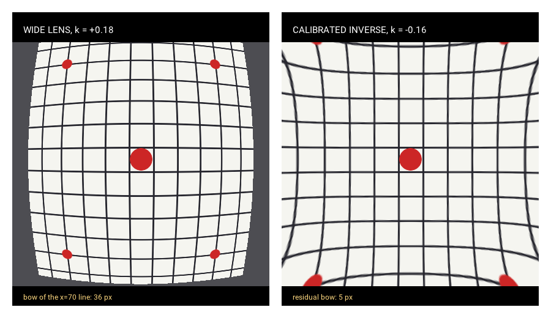<br>`lmctl autorun https://raw.githubusercontent.com/lmctl-ai/lmimg/main/examples/lens_undistort.lms` |

### Production: sheets, sprites, batches

| | |
| --- | --- |
| **Contact sheet** for a shoot: six exposures/white balances, centred captions.<br>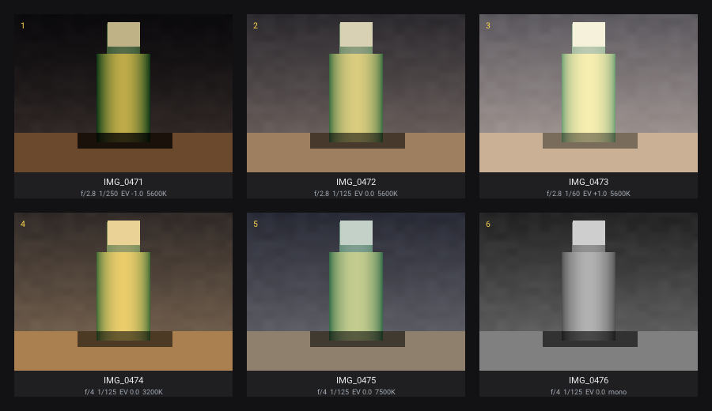<br>`lmctl autorun https://raw.githubusercontent.com/lmctl-ai/lmimg/main/examples/contact_sheet_shoot.lms` | **Sprite atlas and GIF**: squash-and-stretch frames with a blurred contact shadow packed into fixed cells.<br>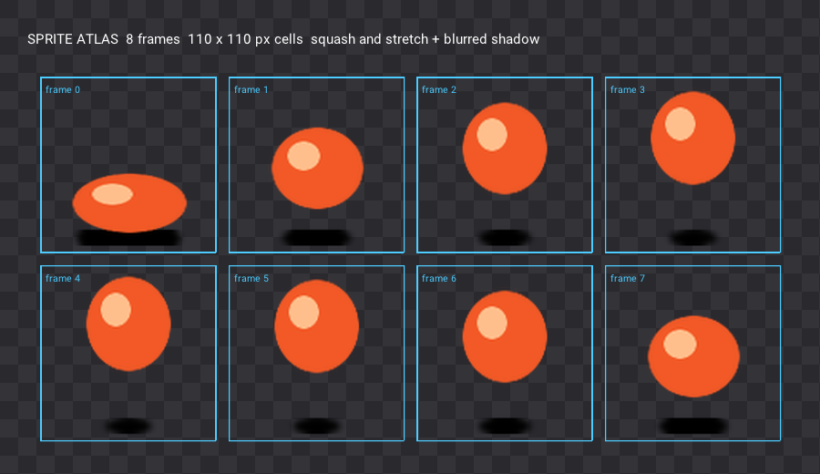<br>`lmctl autorun https://raw.githubusercontent.com/lmctl-ai/lmimg/main/examples/sprite_sheet.lms` |
| **Batch resize**: three aspect-preserving deliverables plus a labelled sheet.<br>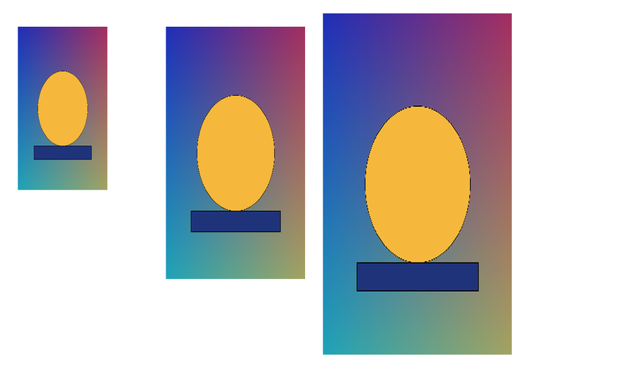<br>`lmctl autorun https://raw.githubusercontent.com/lmctl-ai/lmimg/main/examples/batch_resize.lms` | **Catalogue variants**: four colourways on one sheet.<br>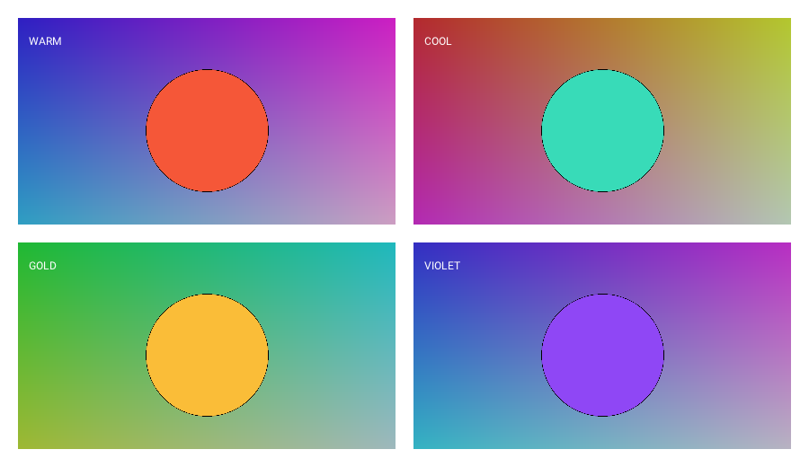<br>`lmctl autorun https://raw.githubusercontent.com/lmctl-ai/lmimg/main/examples/contact_sheet_story.lms` |
| <br>`lmctl autorun https://raw.githubusercontent.com/lmctl-ai/lmimg/main/examples/sprite_sheet.lms` | <br>`lmctl autorun https://raw.githubusercontent.com/lmctl-ai/lmimg/main/examples/animation_wave.lms` |

### Basics

| | |
| --- | --- |
| 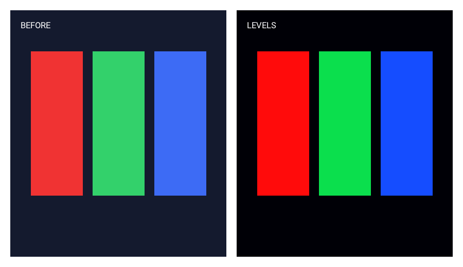<br>`lmctl autorun https://raw.githubusercontent.com/lmctl-ai/lmimg/main/examples/gradient_studio.lms` | 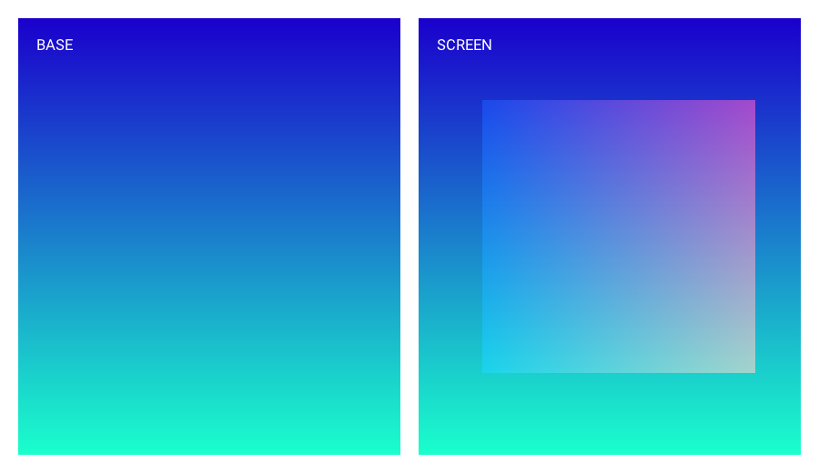<br>`lmctl autorun https://raw.githubusercontent.com/lmctl-ai/lmimg/main/examples/blend_modes.lms` |
| 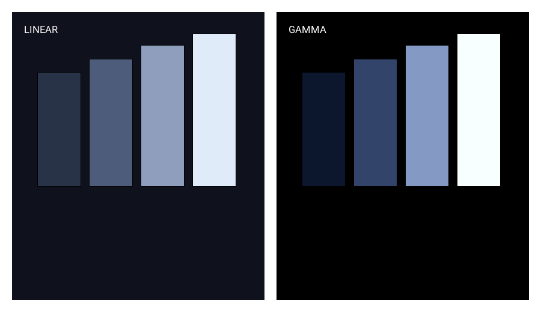<br>`lmctl autorun https://raw.githubusercontent.com/lmctl-ai/lmimg/main/examples/levels_lab.lms` | 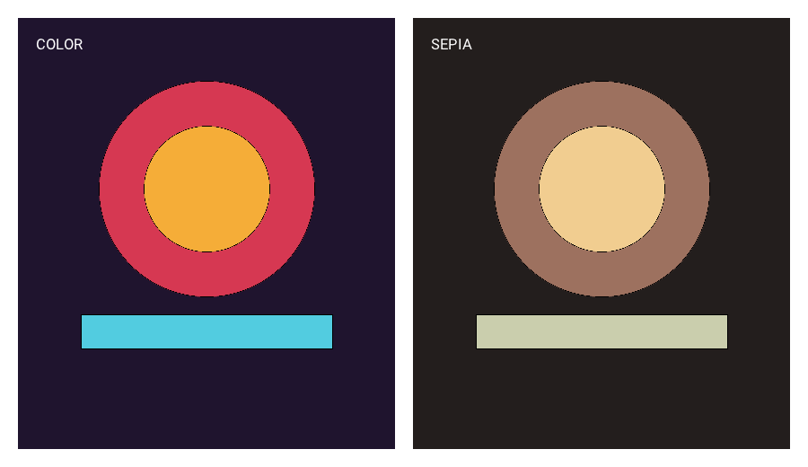<br>`lmctl autorun https://raw.githubusercontent.com/lmctl-ai/lmimg/main/examples/sepia_poster.lms` |
| 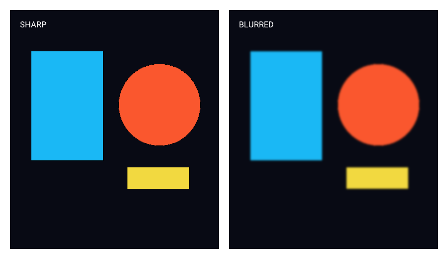<br>`lmctl autorun https://raw.githubusercontent.com/lmctl-ai/lmimg/main/examples/blur_reveal.lms` | 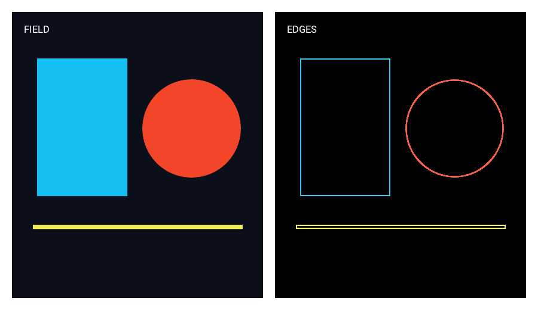<br>`lmctl autorun https://raw.githubusercontent.com/lmctl-ai/lmimg/main/examples/edge_map.lms` |
| 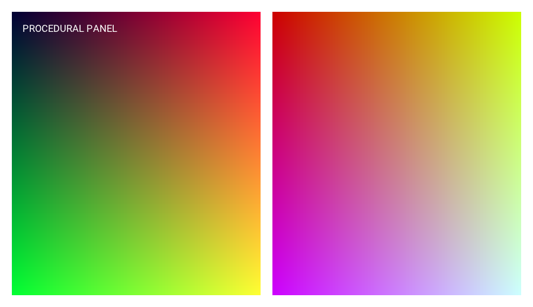<br>`lmctl autorun https://raw.githubusercontent.com/lmctl-ai/lmimg/main/examples/thumbnail_grid.lms` | 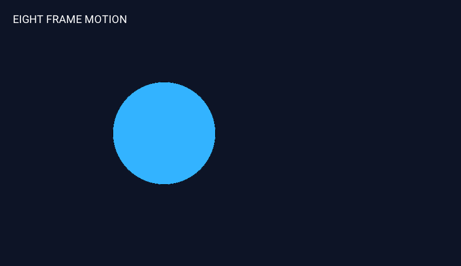<br>`lmctl autorun https://raw.githubusercontent.com/lmctl-ai/lmimg/main/examples/animation_wave.lms` |
| 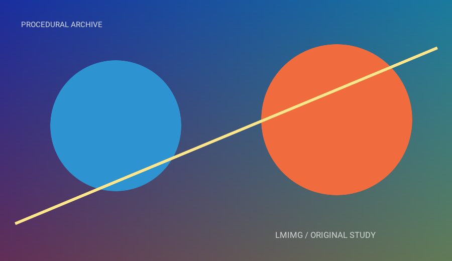<br>`lmctl autorun https://raw.githubusercontent.com/lmctl-ai/lmimg/main/examples/watermark_story.lms` | 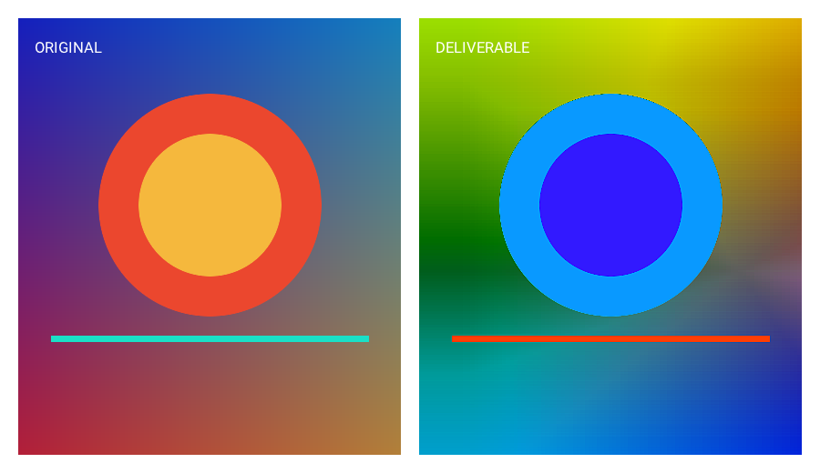<br>`lmctl autorun https://raw.githubusercontent.com/lmctl-ai/lmimg/main/examples/before_after_panels.lms` |

## Install lmctl

Everything in this repository runs through [lmctl](https://lmctl.com), the core tool of the lmctl family. Install it once, then run any `.lms` file or raw URL:

```bash
npm install -g @lmctl-ai/lmctl
lmctl autorun examples/animation_wave.lms
lmctl autorun https://raw.githubusercontent.com/lmctl-ai/lmimg/main/examples/animation_wave.lms
```

## Quickstart

Install an autorun-capable [lmctl](https://github.com/lmctl-ai/lmctl) (0.2.401 or newer), then paste any caption above into a terminal. The current lmimg [release](https://github.com/lmctl-ai/lmimg/releases) contains self-contained Linux x64/arm64 binaries with dynamic glibc >= 2.35; all third-party libraries, fonts and codecs are linked statically, so no ImageMagick, fonts or codec DLLs are needed. Earlier releases may contain macOS and Windows assets; those platforms are not produced by the current lane. The script runs itself, checks its own numbers and writes `images/<example>.png` in the current directory. Examples that combine hosts install lmplot or lmdraw the same way.

```lms
p = _lmcode_ cli="lmimg" install="github:lmctl-ai/lmimg@latest";
let original = img.pattern(440, 260, "x", "y", "0.2", "1");
let edited = original.copy().levels(0.1, 0.8, 0.9);
let panel = img.panel(original, edited, 4);
panel.save("images/comparison.png");
img.assert_close(original.ssim(original), 1.0, 0.000001);
end _lmcode_
savedsl(p, "comparison.dslb");
r = system ${dsl_cli(p)} --lmcode comparison.dslb;
assert(r.code == 0);
```

All image edits mutate their receiver and return it for chaining; use `copy()` first when the original must survive. Dimensions and coordinates are pixels; RGBA channels are normalized to `[0,1]` and stored as 8 bits per channel. `pattern` expressions use normalized `x`, `y`, the arithmetic and functions in the expression note, plus `hash(x,y,seed)` (white noise) and `noise(x,y,seed)` (smooth value noise) for procedural textures.

## API

| Task | API |
| --- | --- |
| Create / load | `img.canvas(w,h,r,g,b,a)`, `img.pattern(w,h,R,G,B,A)`, `img.open(path)`, `img.hald(level)` |
| Copy / save | `image.copy()`, `image.save(path)` |
| Inspect / edit pixels | `width()`, `height()`, `pixel(x,y,channel)`, `set_pixel(x,y,r,g,b,a)` |
| Geometry | `resize`, `crop`, `rotate`, `flip`, `perspective`, `lens` (bilinear resampling) |
| Tone and colour | `levels`, `curves`, `curves_rgb(r,g,b)`, `hsl`, `channelmix`, `grayscale`, `sepia`, `invert`, `threshold`, `normalize`, `equalize`, `colormap(name)`, `clut(hald)` |
| Filters | `blur` (feathers alpha, premultiplied), `sharpen`, `edges`, `morphology`, `unsharp`, `vignette`, `tilt_shift` |
| Compositing | `blend(image,mode,opacity,x,y)`, `mask`, rectangular `selection`, `img.layers(w,h)` with `Layers.add(image,mode,opacity,x,y)`, `Layers.masked(image,mask,mode,opacity,x,y)`, `Layers.render()` |
| Repair / builders | `heal` (planar fit of the surrounding ring), `img.curve().point(x,y)`, `img.montage()` with `Montage.add(image)`, `Montage.render(columns,gap,r,g,b,a)` |
| Drawing | `rect`, `circle`, `line`, `text` with the embedded font, `img.text_width(text,size)` |
| Measurements | `mean`, `stddev`, `min`, `max`, `histogram(csv)`, `psnr`, `ssim`, `property(key)`, `metadata(key,value)` |
| Sheets / GIF | `img.panel(a,b,gap)`, `img.animation()` with `Animation.add(frame,delay)`, `Animation.size()`, `Animation.save(path)` |
| Utilities | `img.eval(expression)`, `img.assert_true`, `img.assert_close`, `img.print(value)` |

Blend and layer modes: `over`, `multiply`, `screen`, `overlay`, `difference`, `darken`, `lighten`, `addition`, `subtract`, `divide` (straight-alpha source-over, opacity applied to the source alpha). Colormaps: `gray`, `heat`, `viridis`, `coolwarm`. Selections are rectangular: `selection(x,y,w,h)` clears alpha outside; use an image mask for other shapes. Morphology radii are 0–16. `img.hald(level)` builds an identity Hald CLUT of side `level^3` (2–16); grade it with any colour operation, save it, and `clut()` applies it with trilinear interpolation. `curves_rgb`, `threshold`, `invert`, `normalize`, `equalize`, `colormap`, `clut`, `hald`, `text_width`, the `divide` mode and the `hash`/`noise` expression functions are new in 0.1.2.

`lmimg --lmcode-signatures` lists exact parameter types; `--lmcode-schema --json` prints the compiler schema. PNG, JPEG, TIFF, WebP, GIF, BMP and PNM (PPM/PGM/PBM) are the supported local raster formats. Animated output is GIF with centisecond delays; `open` reads the first frame of an animated input. Text is ASCII in the embedded Roboto font. Comparison needs equal dimensions. PSNR compares normalized RGBA and is positive infinity for identical images. SSIM is one global luma window with sample covariance and constants 0.01² and 0.03², a compact statistic rather than a multiscale perceptual model.

## Examples

| Story | Run from any empty directory |
| --- | --- |
| Portrait retouch with shading-aware healing | `lmctl autorun https://raw.githubusercontent.com/lmctl-ai/lmimg/main/examples/portrait_retouch.lms` |
| Exposure brackets merged and tone-mapped | `lmctl autorun https://raw.githubusercontent.com/lmctl-ai/lmimg/main/examples/hdr_tone_map.lms` |
| Tilt-shift miniature of an aerial view | `lmctl autorun https://raw.githubusercontent.com/lmctl-ai/lmimg/main/examples/miniature_tilt_shift.lms` |
| Graduated ND, multiply and screen layers | `lmctl autorun https://raw.githubusercontent.com/lmctl-ai/lmimg/main/examples/graduated_nd_layers.lms` |
| Teal-and-orange look as a Hald CLUT | `lmctl autorun https://raw.githubusercontent.com/lmctl-ai/lmimg/main/examples/color_grade_lut.lms` |
| Procedural photo-style grade | `lmctl autorun https://raw.githubusercontent.com/lmctl-ai/lmimg/main/examples/procedural_photo.lms` |
| Scanned invoice cleaned to black on white | `lmctl autorun https://raw.githubusercontent.com/lmctl-ai/lmimg/main/examples/document_scan_cleanup.lms` |
| EAN-13 product label, verified by reading it back | `lmctl autorun https://raw.githubusercontent.com/lmctl-ai/lmimg/main/examples/barcode_label.lms` |
| Event poster with centred type and drop shadows | `lmctl autorun https://raw.githubusercontent.com/lmctl-ai/lmimg/main/examples/poster_text.lms` |
| Tiled diagonal watermark with PSNR | `lmctl autorun https://raw.githubusercontent.com/lmctl-ai/lmimg/main/examples/watermark_tiled.lms` |
| Visual regression heat map with PSNR/SSIM | `lmctl autorun https://raw.githubusercontent.com/lmctl-ai/lmimg/main/examples/image_diff_heatmap.lms` |
| Histogram equalisation plotted with lmplot | `lmctl autorun https://raw.githubusercontent.com/lmctl-ai/lmimg/main/examples/histogram_equalize_plot.lms` |
| Annotated clean-up pipeline drawn with lmdraw | `lmctl autorun https://raw.githubusercontent.com/lmctl-ai/lmimg/main/examples/pipeline_diagram.lms` |
| Median versus Gaussian on salt-and-pepper noise | `lmctl autorun https://raw.githubusercontent.com/lmctl-ai/lmimg/main/examples/salt_pepper_denoise.lms` |
| Keystone correction of a whiteboard photo | `lmctl autorun https://raw.githubusercontent.com/lmctl-ai/lmimg/main/examples/perspective_whiteboard.lms` |
| Lens distortion calibrated by sweep | `lmctl autorun https://raw.githubusercontent.com/lmctl-ai/lmimg/main/examples/lens_undistort.lms` |
| Contact sheet of a product shoot | `lmctl autorun https://raw.githubusercontent.com/lmctl-ai/lmimg/main/examples/contact_sheet_shoot.lms` |
| Sprite atlas and GIF with squash and stretch | `lmctl autorun https://raw.githubusercontent.com/lmctl-ai/lmimg/main/examples/sprite_sheet.lms` |
| Batch resizing three deliverables | `lmctl autorun https://raw.githubusercontent.com/lmctl-ai/lmimg/main/examples/batch_resize.lms` |
| Four-up catalogue sheet | `lmctl autorun https://raw.githubusercontent.com/lmctl-ai/lmimg/main/examples/contact_sheet_story.lms` |
| Before and after delivery panels | `lmctl autorun https://raw.githubusercontent.com/lmctl-ai/lmimg/main/examples/before_after_panels.lms` |
| Watermarking an original study | `lmctl autorun https://raw.githubusercontent.com/lmctl-ai/lmimg/main/examples/watermark_story.lms` |
| Procedural colour studio (levels) | `lmctl autorun https://raw.githubusercontent.com/lmctl-ai/lmimg/main/examples/gradient_studio.lms` |
| Screen compositing | `lmctl autorun https://raw.githubusercontent.com/lmctl-ai/lmimg/main/examples/blend_modes.lms` |
| Recovering tonal contrast | `lmctl autorun https://raw.githubusercontent.com/lmctl-ai/lmimg/main/examples/levels_lab.lms` |
| A warm print treatment | `lmctl autorun https://raw.githubusercontent.com/lmctl-ai/lmimg/main/examples/sepia_poster.lms` |
| Softening geometric boundaries | `lmctl autorun https://raw.githubusercontent.com/lmctl-ai/lmimg/main/examples/blur_reveal.lms` |
| Finding boundaries | `lmctl autorun https://raw.githubusercontent.com/lmctl-ai/lmimg/main/examples/edge_map.lms` |
| A procedural contact sheet | `lmctl autorun https://raw.githubusercontent.com/lmctl-ai/lmimg/main/examples/thumbnail_grid.lms` |
| A moving colour wave (GIF) | `lmctl autorun https://raw.githubusercontent.com/lmctl-ai/lmimg/main/examples/animation_wave.lms` |

Regenerate the committed gallery with `examples/render-all.sh` (lmplot and lmdraw on `PATH` for the two combo figures). Every example compiles and executes itself, asserts its results, and prints its output path.

## Limits worth knowing

- 8 bits per channel, no colour management; operations work on gamma-encoded sRGB values (so `grayscale` is Rec.709 luma of the encoded values).
- `rotate` by non-right angles yields ImageMagick's shear-based extent, slightly larger than the bounding box; `perspective` and `lens` resample bilinearly and leave out-of-frame samples transparent.
- `heal` fits a plane to the ring around the patch: good for skin and gradients, not a texture synthesizer. Selections are rectangles; build masks for other shapes.
- `blur` feathers alpha (premultiplied); `sharpen` and `edges` act on RGB and keep alpha.
- Text is ASCII only. SSIM is a single global window.

## Relationship to GIMP

lmimg is a scripting host with a small, original MIT implementation of editing ideas such as layers, masks, curves, selections, healing-lite, LUTs, perspective/lens transforms and selective-focus filters. It does not link GIMP or GEGL and does not use their source. ImageMagick supplies the static raster and codec engine. Its license and the permissive licenses for the pinned codecs (zlib, libpng, libjpeg-turbo, libtiff, libwebp), stb_truetype and the embedded Roboto font are included in [THIRD_PARTY_NOTICES](THIRD_PARTY_NOTICES), also printed by `lmimg --notices`. The build refuses any other ImageMagick delegate (pango, graphviz, lcms, freetype and the rest are configured off and asserted absent), so no GPL or LGPL image library is linked.

## Resource limits and command surface

The default total memory budget is **4096 MiB**; set `LMIMG_MAX_MEMORY_MB` to a positive whole number of MiB to change it (invalid values exit 2). The host counts C++ allocations and conservatively charges native image storage, checking known temporary peaks before allocation. Exceeding the budget exits 3 with a JSON error on stdout and one stderr line naming `LMIMG_MAX_MEMORY_MB`.

```text
lmimg --lmcode FILE [FILE ...] [--dry-run]
lmimg --version
lmimg --notices
lmimg --lmcode-schema [--json]
lmimg --lmcode-signatures
```

Usage errors exit 2; bytecode-load and execution failures exit 3 with JSON on stdout and a diagnostic on stderr. A dry run verifies bytecode without running image operations.

## Build and verification

```sh
private implementation detail
private implementation detail --verify
./test.sh
```

CMake builds the pinned source dependencies into one executable. `test.sh` checks native pixel/codec/math oracles, DSL/compiler signatures, every example, byte-identical reruns, error paths, notices, platform linkage (dynamic glibc >= 2.35 allowlist on Linux, static third-party libraries everywhere) and memory-limit failures; CI runs the same suite on the Linux x64 and arm64 release builds. See durable-memory for pins, implementation decisions, measured results and release evidence.

## License


Releases up to and including v0.1.3 were published under the MIT License (see the LICENSE asset of that release). Releases after v0.1.3 are published under the Lattice Systems Binary License 1.0 (this file).
The README, docs, images, and `examples/*.lms` are MIT-licensed under `LICENSE-examples`.
Binary releases are licensed under `LICENSE`. Third-party components remain under their own licenses and notices.
